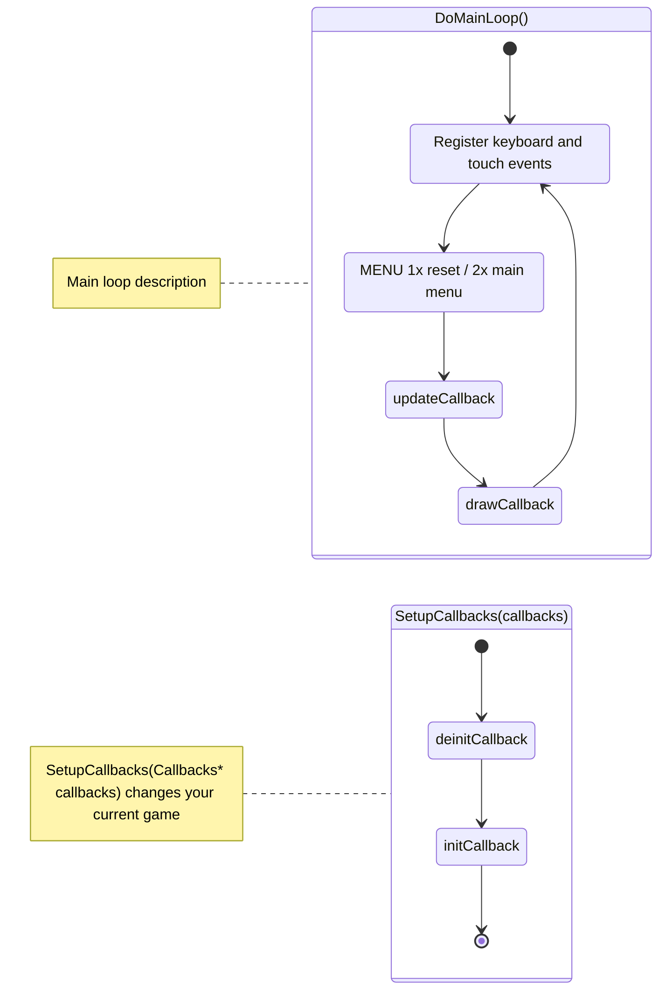
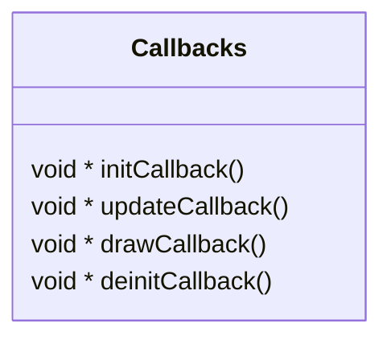

# Raspberry Pico Pocket Gamer

A Raspberry Pico __RP2040__ and __ILI9341__ based pocket console.

[Featured on MagPi Issue #122](https://magpi.raspberrypi.com/articles/pico-pocket-gamer)

> Watch the video by clicking on the image

[](https://www.youtube.com/watch?v=271OoiJQUyk "Raspberry Pico Pocket Gamer Video")


## Description

Since the Pico came out I wanted to create a project for it that I can show my son to, so I decided to make him a Pocket Console. The game repertoire consists of twenty three different games, five of which are rendered with the built in software 3d engine.

## Game list
|               |               |                |
|:-------------:|:-------------:|:--------------:|
| TicTacToe 1P  | Labirinth     | Snake          |
| TicTacToe 2P  | Connect4 1P   | Calculator     |
| Lights Out    | Connect4 2P   | Pong           |
| Math          | 2048          | Breakout       |
| Tetramino     | Paint.NOT     | Q*bert (3d)    |
| Mission Ctrl (3d) | Asteroids (3d) | Frogger (3d) |
| Tunnel Rush (3d) | Missile Def  | PacMan         |
| Invaders      | Turbo Drive (3d) |             |

## The 3d engine (`src/gpu3d.c`)

A small fixed point (16.16) software renderer, written for the RP2040 which has
no FPU:

* sine/cosine from a 1 KiB flash lookup table (1024 steps per turn),
* perspective and orthographic projection with near plane clipping,
* painter's algorithm depth sorting per object, back face culling,
* flat shading with one directional light plus an ambient term,
* convex polygon fill and affine texture mapping of the 64x64 GPU texture,
* ready made meshes: cube, textured cube, ball, pyramid and a horizontal quad.

The main menu shows a rotating cube with the raspberry sprite mapped onto its
faces, Q*bert builds its pyramid out of shaded cubes, Mission Control renders a
3d terrain and the landing module, Asteroids tumbles real 3d rock bodies as
wireframes, Frogger looks at the road and the river through a perspective
camera and Turbo Drive renders the whole road out of 3d quads.

## Controls

Five switches: `UP`, `DOWN`, `LEFT`, `RIGHT` and `MENU`, plus the touchscreen.

The `MENU` switch is the reset button of the console:

* __one press__ restarts the running game,
* __two presses within 0.4 s__ return to the main menu.

Switches are debounced in software (`src/gameshared.c`), so a bouncing contact
can never be mistaken for a double press.

The main menu can be operated with the touchscreen as well: tap a name to
select it, tap the selected name again to start it.

## Touchscreen

The XPT2046 driver (`src/interface/ili9341_touchscreen.c` + `src/touch.c`)
collects up to eight raw conversions per poll and turns them into one position
with a trimmed mean (the extreme samples are dropped), which removes the single
wild readings a resistive panel produces. The SPI clock was lowered into the
specified range of the XPT2046 and the first conversion after chip select is
discarded because the internal reference needs to settle. `Touch_Update()` in
`src/gameshared.c` additionally filters jitter between polls and reports press
and release edges, which is what the games use for buttons.

The calibration constants live at the top of `src/touch.c`; if the touch feels
off on your panel, adjust `TOUCH_MIN/MAX_RAW_X/Y` there.

## How to compile/run ?

Steps are similar (same) as with any other C++ Pico SDK based project.

```bash
mkdir build
cd build
cmake ..
make -j${nproc}
```

After which you should be able to find `build/PocketGamer.uf2` file to upload to your Pico microcontroller.

> __HINT__: In case you want to try the project without the Pico board `cd` into the `extras` folder and do a `make run`. I've adapted the interface and the main function to run on top of the olc's PixelGameEngine so you can try it directly from your Linux PC. Controls are `QWASD` and mouse click (`Q` is the MENU/reset switch).

### Tests

The very same sources are exercised on the host by a test runner:

```bash
cd extras
make test         # unit tests + a smoke test of every game (900+ checks)
make test-asan    # the same under AddressSanitizer + UBSan
make shot NAME=qbert FRAMES=120     # render frames of a game to build/qbert.png
```

`make shot` accepts every name from the menu plus `menu`, and an optional
`MODE=idle` to run without simulated input. The runner covers the pixel
format, the font rasterizer, line clipping, the touch calibration and filter,
the switch debouncing, the random generator, the 3d math (including the winding
of every built in mesh), the painter's algorithm, the menu button behaviour and
runs all games with pseudo random input.

## Pinout
You should be able to find a compressed __gerber__ file with `extras` directory of the repository and order a new PCB online on which you can solder all the elements easily.

ILI9341 to Pico pin connections looks like this:
 
```
 ILI9341         Pico (RP2040)
 
 T_IRQ  <-----> PIN 20
 T_DO   <-----> PIN 8
 T_DIN  <-----> PIN 11
 T_CS   <-----> PIN 21
 T_CLK  <-----> PIN 10
 SDO    <-----> PIN 4
 LED    <-----> PIN 26 (or directly to 3v3)
 SCK    <-----> PIN 6
 SDI    <-----> PIN 7
 DC     <-----> PIN 18
 RESET  <-----> PIN 17
 CS     <-----> PIN 16
 GND    <-----> GND
 VCC    <-----> 3V3

```
 
 Additionally keyboard switches are added to the following pins:
 
```
                   Pico (RP2040)
 
 KEY_MENU  <-----> PIN 0
 KEY_UP    <-----> PIN 15
 KEY_DOWN  <-----> PIN 27
 KEY_LEFT  <-----> PIN 28
 KEY_RIGHT <-----> PIN 14

```

In case you need to change them they are all defined within their own source files: `src/interface.c`, `src/interface/ili9341.c` and `src/interface/ili9341_touchscreen.c`.

## Code explanation





> Should I add more detailed info here?
