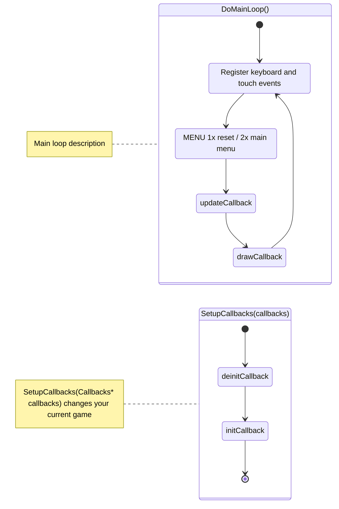
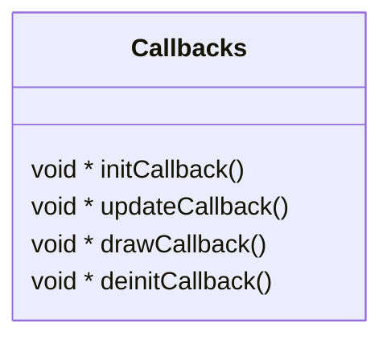

# Raspberry Pico Pocket Gamer

A Raspberry Pico __RP2040__ and __ILI9341__ based pocket console.

[Featured on MagPi Issue #122](https://magpi.raspberrypi.com/articles/pico-pocket-gamer)

> Watch the video by clicking on the image

[](https://www.youtube.com/watch?v=271OoiJQUyk "Raspberry Pico Pocket Gamer Video")


## Description

Since the Pico came out I wanted to create a project for it that I can show my son to, so I decided to make him a Pocket Console. The game repertoire consists of thirty-eight different games, five of which are rendered with the built in software 3d engine.

## Game list
|               |               |                |
|:-------------:|:-------------:|:--------------:|
| TicTacToe 1P  | Labirinth     | Snake          |
| TicTacToe 2P  | Connect4 1P   | Calculator     |
| Lights Out    | Connect4 2P   | Pong           |
| Math          | 2048          | Breakout       |
| Tetramino     | Paint.NOT     | Q*bert (3d)    |
| Mission Ctrl (3d) | Asteroids (3d) | Frogger (3d) |
| Tunnel Rush (3d) | Missile Def  | PacMan         |
| Invaders      | Turbo Drive (3d) | Minesweeper  |
| Simon         | Flappy Bird   | Memory         |
| Sokoban       | Whack-a-mole  | Doodle Jump    |
| Solitaire     | Pinball       | 15 Puzzle      |
| Flood-It      | Reversi       | Hangman        |
| Bomberman     | Tank Fight    |                |

## Graphics & gameplay

Every game is drawn with a small set of shared, RP2040-friendly effects
(`src/gpu.c`): twinkling starfields, soft radial glows, 1-bit bitmap sprites,
stateless explosion bursts and HUD progress bars. They are deliberately cheap
(a few dozen to a few hundred pixels each) so the software renderer keeps its
30 fps frame budget. On top of that each game has its own polish - neon glows,
motion trails, drop animations, parallax backgrounds, screen-edge speed streaks
and particle bursts.

Gameplay was deepened across the board, for example: a ghost-piece landing
preview and hard drop in Tetramino, wall kicks and level speed-up; undo in 2048;
falling power-ups in Breakout; a golden bonus fruit in Snake; bonus fruit in
PacMan; a bonus fly in Frogger; shield power-up in Invaders; perfect-wave and
perfect-level bonuses in Asteroids and Q*bert; near-miss bonuses in Tunnel Rush
and Turbo Drive; a landing streak in Mission Control; a session win/loss record
in TicTacToe; and a fork-aware TicTacToe AI. The seven added games (Minesweeper,
Simon, Flappy Bird, Memory, Sokoban, Whack-a-mole, Doodle Jump) all work with
both the switches and the touchscreen.

A later pass focused on readability and feel: Tunnel Rush's obstacle walls are
now filled solid colour (with a bright rim on the edge facing the player) instead
of a hard-to-read wireframe, so the gap is obvious at a glance. Turbo Drive gained
a chargeable nitro boost (UP+DOWN, or the on-screen NITRO button), an overtake
combo, roadside posts and trees for a stronger sense of speed, a horizon sun and
a nitro/speed HUD. Missile Defense's explosions were fixed: the radius used to
oscillate at its peak forever, so blasts never cleared and the next wave could
never start - they now grow, shrink and expire properly, and waves advance.

The newest pass polished the shared visuals and deepened a few more games:

* **Balls look like balls.** A new shared `GPU_DrawBall()` sprite shades every
  ball with a dark rim, a lit body and a specular highlight (Pong, Breakout,
  Connect4, Lights Out), and the 3d engine's ball mesh grew from a chunky
  8-face octahedron into a proper 32-face low-poly sphere. The shared filled
  circle itself was fixed too: it seeded a vertical line and never emitted the
  middle row, leaving a one-pixel horizontal gap through the centre of every
  disc - now every row is solid (regression-tested for radii 1..24).
* **Labyrinth** gained touchscreen steering (sides of the view turn, the middle
  walks), six collectible gems rendered as depth-tested billboards in the 3d
  view, distance fog and a best-time record.
* **Memory** had a timing bug: its logic ran once per main loop iteration instead
  of once per game tick, so a mismatched pair flipped back after a few
  milliseconds and the cursor raced across the board. It now runs on the same
  20 Hz tick as every other game, so mismatches stay visible for a second.
* **Turbo Drive** got more modern traffic: cars indicate and change lanes, and
  drafting behind a car (slipstream) charges the nitro faster and pulls you
  along - draft, then swing out and overtake.
* **Tunnel Rush** controls were mirrored: the ship now rides at the bottom of
  the tunnel and LEFT/RIGHT steer in the direction you see on screen.
* **Breakout** gained multiball and extra-life power-ups, three player lives,
  and endless levels with harder brick patterns instead of a single board.
* **Calculator** became a scientific calculator: a second keypad page (sqrt,
  x², x^y, 1/x, sin/cos/tan, ln/log, pi, e, %, +/-, backspace), a decimal point,
  a DEG/RAD switch and proper error handling - all formatted without printf
  float support, which the RP2040 SDK does not carry.
* **Solitaire** (Klondike, draw one) joined the menu: full rules, undo, an
  AUTO button that sweeps cards into the foundations, move counter, timer and
  best time. It works with the touchscreen (tap card, tap destination, tap a
  selection again to send it home) and with the switches (LEFT/RIGHT pick a
  pile, UP the card, DOWN selects/places). It was then made much easier to
  learn: cards carry real suit symbols (red hearts/diamonds, black
  spades/clubs) with a big pip in the centre, the stock shows how many cards
  are left and a recycle arrow when empty, every legal destination is outlined
  in green while a card is selected, and a HOW TO PLAY overlay behind a HELP
  button explains the rules on demand (it no longer pops up before the game).
  Any card may start an empty tableau column, not just kings.
* **Pinball** joined the menu: a portrait table with a plunger launch lane,
  three big bumpers, two mini bumpers, a bank of three drop targets (clearing
  it pays a bonus), two lane posts, three top rollovers that raise the score
  multiplier when all lit, and a centre kickout saucer that throws the ball
  back up the table. Two flippers guard the drain and there are three balls
  per game. It is tuned to be forgiving - long flippers over a narrow drain, a
  strong flip impulse, gentle gravity and a few seconds of ball save after
  every launch. The physics runs at 60 Hz with sub-stepped collision so a fast
  ball never tunnels through a wall or flipper. LEFT/RIGHT (or the left/right
  half of the table on touch) work the flippers; DOWN/UP or the LAUNCH button
  charges the plunger and releases the ball.

## Bug hunt & four more games

A systematic pass over every game looked for logic and timing bugs. The most
important class of bug: several games decayed animation/feedback counters once
per **main loop iteration** instead of once per game tick or per unit of real
time. The main loop spins far faster than the 30 fps frame rate, so these
"timers" expired in a few milliseconds and the effect was invisible. Fixed:

* **Math** - the CORRECT/WRONG feedback (and the key highlight) now stays on
  screen for a full second instead of vanishing instantly.
* **Calculator** - the pressed-key highlight is now time based.
* **Connect4 (1P & 2P)** - the stone drop animation is now time based (~300 ms)
  so you actually see the stone fall; the 1P AI also ignores input while it is
  thinking so a stray press cannot leak into your next turn.
* **Simon** - the pad flash on input now lasts a quarter of a second.
* **Sokoban** - the "SOLVED!" banner is shown for ~1.5 s of real time.
* **Doodle Jump** - the game-over screen waits ~0.7 s before a tap restarts, so
  you can read your score instead of instantly restarting by accident.

Other logic fixes:

* **Sokoban** - a blocked push used to leave a phantom undo entry, so pressing
  UNDO afterwards silently decremented the move counter. A blocked move no
  longer creates an undo (regression-tested).
* **Whack-a-mole** - the spawn interval underflowed at score ≥ 2400, so no mole
  ever appeared again; it is now clamped.
* **Frogger** - the car/log arrays were too small, leaving the last road lane
  empty and the last river lane with a single log; both are now fully populated.
* **Tunnel Rush** - crashing no longer wipes the distance part of your score.
* **Breakout** - multiball clones now always fan out to opposite sides.
* **Q*bert** - Coaly no longer parks forever on the bottom row; he hops off and
  a new one spawns, like the arcade.
* **2048** - the best score is kept outside the shared memory (it used to be
  wiped by visiting another game) and the win banner resets on a new game.
* **Mission Control** - the landing streak resets on a new game.
* **Snake** - quick successive turns are buffered (a fast "up then left" used to
  lose the first turn and send you into the wall), and the record is saved as
  soon as you grow, not only on death.
* **Solitaire** - dismissing the HELP overlay no longer leaks the tap into the
  board as an unintended move.
* **GPU** - `GPU_ShadeColor()` now actually brightens for levels > 256 as
  documented, so the lit top/left edge of every bevelled button/tile shows up.

The touch-only games **TicTacToe**, **Lights Out** and **Math** also gained
switch support: the arrows move a cursor and UP+DOWN together acts (the same
convention Whack-a-mole uses), so every game now works with both the switches
and the touchscreen.

Four new games joined the menu, all switch + touch:

* **15 Puzzle** - the classic sliding tiles. Scrambled by random legal moves so
  it is always solvable; arrows slide a tile, tapping a row/column slides the
  whole segment. Move counter, timer and best score.
* **Flood-It** - flood the board from the top-left corner with one colour within
  a move limit. LEFT/RIGHT pick a colour, UP/DOWN flood, or tap the palette.
  Each level gets a little harder.
* **Reversi** - outflank the computer on an 8x8 board. Legal moves are hinted,
  passes are handled, and the AI weighs corners/edges against the trap squares
  next to an empty corner. Session win/loss record.
* **Hangman** - guess the word (with a category hint) before the figure is
  complete. A 50+ word kid-friendly list, an alphabet grid, and a win/loss
  record.

## Bomberman & Tank Fight

Two action games joined the menu, both switch + touch. Because the console only
has four direction switches plus MENU, the action button is **UP+DOWN pressed
together** (the same convention the grid games use); on the touchscreen you steer
by holding a finger on the board and tap the on-screen **BOMB** / **FIRE** button.

* **Bomberman** - a 15x11 maze of solid pillars and blastable blocks, with
  **smooth free movement**: you glide pixel-by-pixel (any position between the
  blocks) and slide around corners, not hop tile-to-tile. Drop bombs that
  explode into a cross of flame after a short fuse; flames destroy blocks,
  chain-detonate other bombs and kill anything caught in them. The enemies are
  **rival bombermen who lay their own bombs** - they hunt you and blast blocks to
  dig through. They are smart about survival: each one only drops a bomb when it
  can path-find to a safe tile before the fuse burns down, then flees along that
  route and centres itself clear of the blast, and it never willingly walks into
  a flame. **Friendly fire is on**, so rivals can still catch each other (and
  occasionally themselves) in a blast. You are hurt **only by flame**, never by
  touching them. Blocks hide a varied set of power-ups: extra bomb (B), bigger
  flame (F), speed (S), a one-hit shield vest (V), an extra life (+) and piercing
  flames that run through blocks (P). **Eliminate every rival to clear the
  level.** Three lives, rising enemy count/speed, score and best score.
* **Tank Fight** - a Battle City-style arena of destructible brick and solid
  steel. Drive your tank, shoot the enemy tanks that spawn in waves, and use the
  bricks as cover (your shots break them, steel stops everything). **Each enemy
  colour has its own AI**: the red *hunter* is fast and chases hard, firing the
  moment it has a clear shot; the magenta *ambusher* keeps its distance and
  snaps onto an open line for accurate aimed shots; the orange *brute* is slow
  but sprays forward constantly, chewing through brick walls to open a path.
  Clear every wave to advance; three lives, score and best score.

Both games run on a fixed 30 Hz tick with a catch-up clamp, and both were found
to share a subtle bug during testing: they read only the *held* keys while
playing, so the key-*press* latch piled up and, on game over, a stale press
instantly restarted the game. The latch is now drained every tick.

## The 3d engine (`src/gpu3d.c`)

A small fixed point (16.16) software renderer, written for the RP2040 which has
no FPU:

* sine/cosine from a 1 KiB flash lookup table (1024 steps per turn),
* perspective and orthographic projection with near plane clipping,
* painter's algorithm depth sorting per object, back face culling,
* flat shading with one directional light plus an ambient term,
* convex polygon fill and affine texture mapping of the 64x64 GPU texture,
* ready made meshes: cube, textured cube, ball (a 32 face low poly sphere),
  pyramid and a horizontal quad.

The main menu shows a rotating cube with the raspberry sprite mapped onto its
faces, Q*bert builds its pyramid out of shaded cubes, Mission Control renders a
3d terrain and the landing module, Asteroids tumbles real 3d rock bodies as
wireframes, Frogger looks at the road and the river through a perspective
camera and Turbo Drive renders the whole road out of 3d quads.

## Controls

Five switches: `UP`, `DOWN`, `LEFT`, `RIGHT` and `MENU`, plus the touchscreen.

The `MENU` switch is the reset button of the console:

* __one press__ restarts the running game,
* __two presses within 0.4 s__ return to the main menu.

Switches are debounced in software (`src/gameshared.c`), so a bouncing contact
can never be mistaken for a double press.

The main menu can be operated with the touchscreen as well: tap a name to
select it, tap the selected name again to start it.

## Touchscreen

The XPT2046 driver (`src/interface/ili9341_touchscreen.c` + `src/touch.c`)
collects up to eight raw conversions per poll and turns them into one position
with a trimmed mean (the extreme samples are dropped), which removes the single
wild readings a resistive panel produces. The SPI clock was lowered into the
specified range of the XPT2046 and the first conversion after chip select is
discarded because the internal reference needs to settle. `Touch_Update()` in
`src/gameshared.c` additionally filters jitter between polls and reports press
and release edges, which is what the games use for buttons.

The calibration constants live at the top of `src/touch.c`; if the touch feels
off on your panel, adjust `TOUCH_MIN/MAX_RAW_X/Y` there.

## How to compile/run ?

Steps are similar (same) as with any other C++ Pico SDK based project.

```bash
mkdir build
cd build
cmake ..
make -j${nproc}
```

After which you should be able to find `build/PocketGamer.uf2` file to upload to your Pico microcontroller.

> __HINT__: In case you want to try the project without the Pico board `cd` into the `extras` folder and do a `make run`. I've adapted the interface and the main function to run on top of the olc's PixelGameEngine so you can try it directly from your Linux PC. Controls are `QWASD` and mouse click (`Q` is the MENU/reset switch).

### Tests

The very same sources are exercised on the host by a test runner:

```bash
cd extras
make test         # unit tests + a smoke test of every game (1000+ checks)
make test-asan    # the same under AddressSanitizer + UBSan
make shot NAME=qbert FRAMES=120     # render frames of a game to build/qbert.png
```

`make shot` accepts every name from the menu plus `menu`, and an optional
`MODE=idle` to run without simulated input. The runner covers the pixel
format, the font rasterizer, line clipping, the touch calibration and filter,
the switch debouncing, the random generator, the 3d math (including the winding
of every built in mesh), the painter's algorithm, the menu button behaviour and
runs all games with pseudo random input.

## Pinout
You should be able to find a compressed __gerber__ file with `extras` directory of the repository and order a new PCB online on which you can solder all the elements easily.

ILI9341 to Pico pin connections looks like this:
 
```
 ILI9341         Pico (RP2040)
 
 T_IRQ  <-----> PIN 20
 T_DO   <-----> PIN 8
 T_DIN  <-----> PIN 11
 T_CS   <-----> PIN 21
 T_CLK  <-----> PIN 10
 SDO    <-----> PIN 4
 LED    <-----> PIN 26 (or directly to 3v3)
 SCK    <-----> PIN 6
 SDI    <-----> PIN 7
 DC     <-----> PIN 18
 RESET  <-----> PIN 17
 CS     <-----> PIN 16
 GND    <-----> GND
 VCC    <-----> 3V3

```
 
 Additionally keyboard switches are added to the following pins:
 
```
                   Pico (RP2040)
 
 KEY_MENU  <-----> PIN 0
 KEY_UP    <-----> PIN 15
 KEY_DOWN  <-----> PIN 27
 KEY_LEFT  <-----> PIN 28
 KEY_RIGHT <-----> PIN 14

```

In case you need to change them they are all defined within their own source files: `src/interface.c`, `src/interface/ili9341.c` and `src/interface/ili9341_touchscreen.c`.

## Code explanation





> Should I add more detailed info here?
